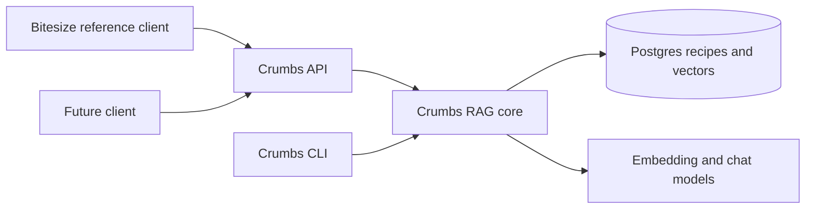
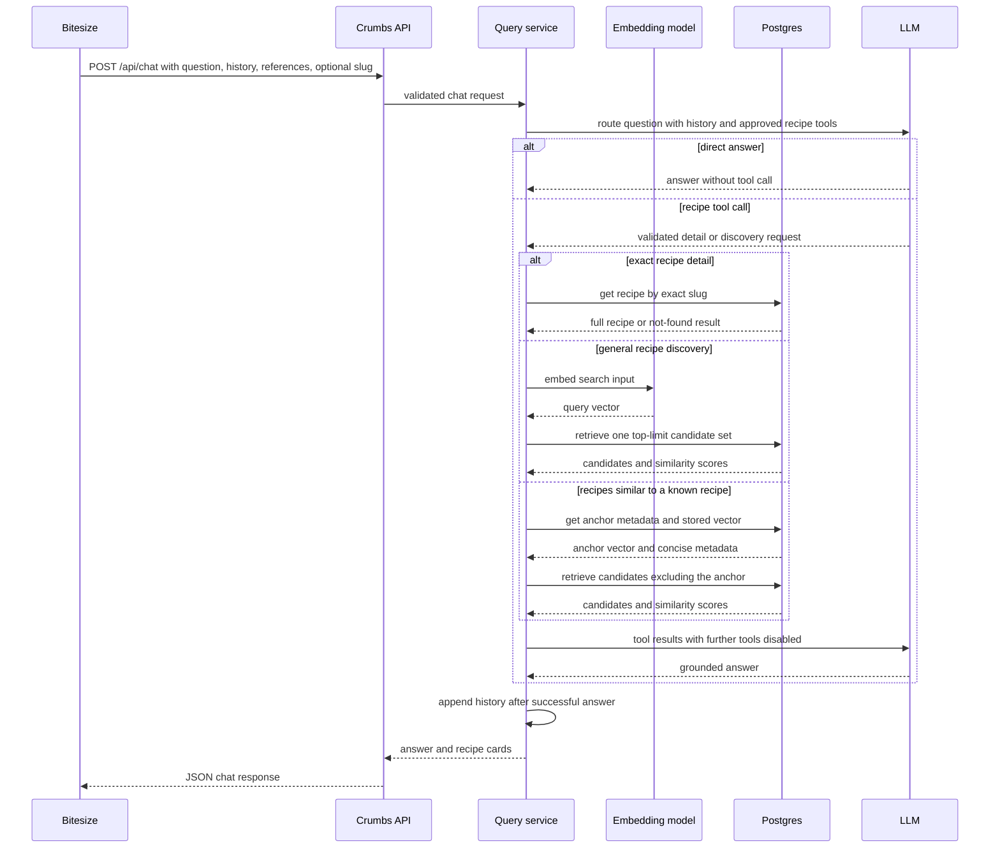

# Crumbs architecture

**Status:** Approved for current MVP direction

## System boundary

Crumbs is the reusable RAG layer and owns recipe ingestion, structured recipe
storage, embeddings, similarity retrieval, and grounded response generation.
Clients consume these capabilities through the shared HTTP API rather than
importing Python modules or connecting directly to Postgres. Bitesize is the
first reference client and belongs under `clients/bitesize/`; it is not part of
the RAG core.

## Repository layout

```text
src/app/          Python RAG, ingestion, database, API, and CLI code
clients/bitesize/ React/Vite reference client
data/             Development recipe corpus and import inputs
docs/             Product, architecture, decision, and operating documentation
```

The Bitesize client remains independently runnable with its own JavaScript
dependencies. The shared API translates the generic Crumbs recipe contract into
the client-facing response shape. Bitesize's existing Express backend and seed
data are not copied into this repository because they represent a separate
recipe schema and persistence flow.

## Stable client contract

The implemented `POST /api/chat` endpoint accepts a question, ordered in-memory history, an
optional application-selected retrieval limit, an optional similarity
threshold, and an optional recipe slug. It returns an object containing the
assistant `answer` and `recipe_cards`. A recipe card contains the persisted
`slug`, `title`, category and tag arrays, time and nutrition metadata, and
numeric `similarity_score`. These are the same condensed fields used by the
home-page recipe cards. The slug is the only navigation identifier exposed to
the client; embeddings and database implementation details are not returned.

The application uses `3` as the default retrieval limit. There is no
product-level maximum in the MVP. The client may render the similarity score as
small, light-gray supporting text.

## Client data flow



The MVP uses one shared corpus for multiple users. Conversation history is
isolated per active application session and is not shared between users. A
future multi-blog deployment must add an explicit corpus or tenant scope to
recipe writes and retrieval before independent corpora are enabled.

## Components

- The shared embedding component creates one vector for either a recipe text or
  a user question using the configured embedding model.
- The query service asks the model to route each message, validates and runs
  approved recipe tools, then grounds a final answer in their results.
- Postgres stores recipes and vectors. The running application owns conversation
  history in memory.
- The router receives text history and compact ordered references to previously
  shown recipes. The model may set the recipe count only when the user requests
  one; application settings supply the default and maximum.

## Data flow



The routing model chooses whether to answer directly or call the validated
`get_recipe_detail` or `get_recipes` tool. Direct answers skip embeddings and
recipe database access. Exact detail lookups use a persisted slug and skip
embedding generation. Discovery requests embed their search text; requests for
recipes similar to a known recipe use its stored embedding and exclude that
recipe. The tool count defaults to three and is capped at ten. A single
unfiltered top-limit query supplies candidates; the application classifies
scores strictly above the shared `0.3` threshold as strong and applies the
weak-result policy without a second query. A final model completion writes an
answer from concise discovery context or full detail content. Recipe cards
always come from validated database rows.

## Persistence

The existing `recipes` table remains the source of recipe content and vectors.
The query feature does not add conversation tables. The running application
maintains an ordered in-memory history of user and assistant messages. System
instructions remain application-controlled rather than becoming user-editable
history. Crumbs has no persistent session-history store, so exiting the process
discards the in-memory history.

Ingredients and instructions are normalized from the raw Markdown parser form
into ordered section arrays before embedding and persistence. Every section
has `kind`, `name`, and `items`; ungrouped sections use `name: null`. PostgreSQL
JSONB stores these canonical sections. Repository reads, RAG prompt context,
and recipe detail API responses retain sections. Bitesize renders section
objects directly and flattens items locally only for ingredient highlighting.

Setup connects to an already-created database and runs the canonical schema in
one transaction. It is intended for a fresh database or one already using the
current schema; it does not upgrade a legacy child-table database. Normal loader
runs still re-embed and upsert each Markdown file present, and do not delete
database recipes for absent files.

For general questions, the query flow generates the query embedding before
leasing a connection and reads the selected complete recipe context and
similarity scores from Postgres. For recipe-specific questions, it reads the
complete recipe directly by slug without generating an embedding. The
similarity results can be projected into condensed recipe cards for the client.
Retrieved recipe context is request-scoped and is not appended to history. The
user and assistant messages are appended to in-memory history only after a
successful answer. If embedding, retrieval, or the LLM request fails, history
is not appended.

## Prompt boundary

The system prompt defines the assistant's behavior and guardrails. Retrieved
recipes are provided as context data, separate from the system instructions.
In-memory conversation history provides continuity during the process lifetime
but cannot override the system prompt or authorize the assistant to invent facts
absent from the retrieved recipes. General recommendation responses use a
numbered list of short prose descriptions that explain why qualifying recipes
fit; the client renders their recipe cards separately beneath the answer. Full ingredients,
instructions, and source details are reserved for explicit detail requests,
where stored Markdown headings and complete recipe content are preserved.
